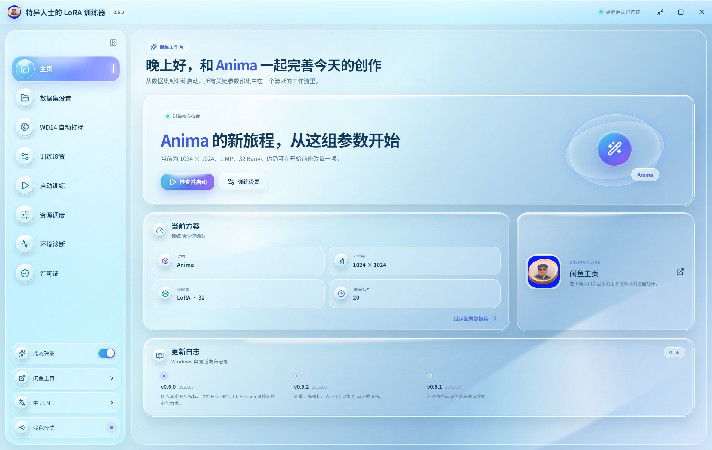
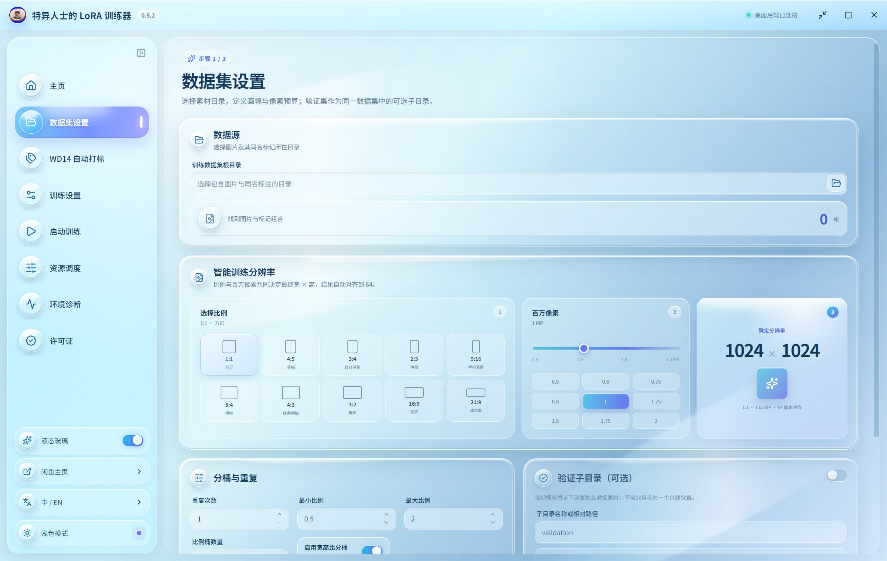
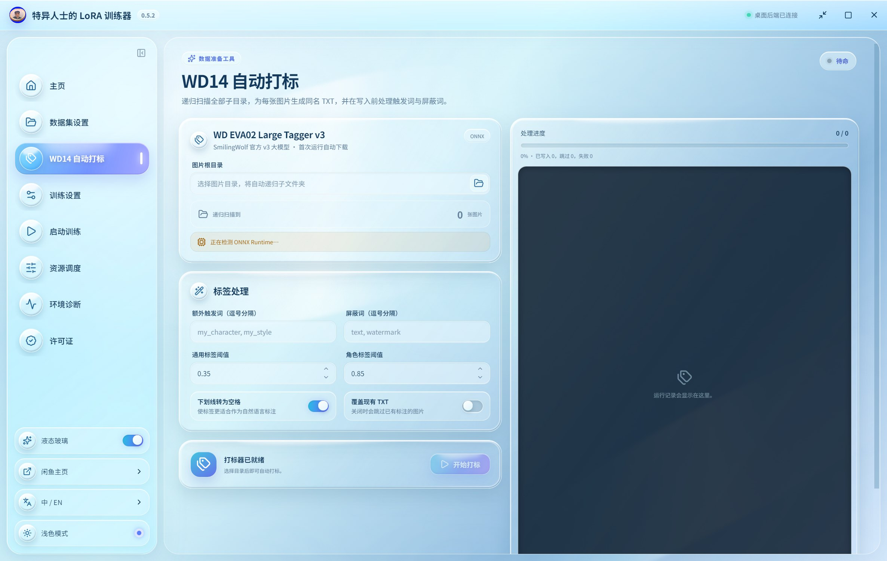
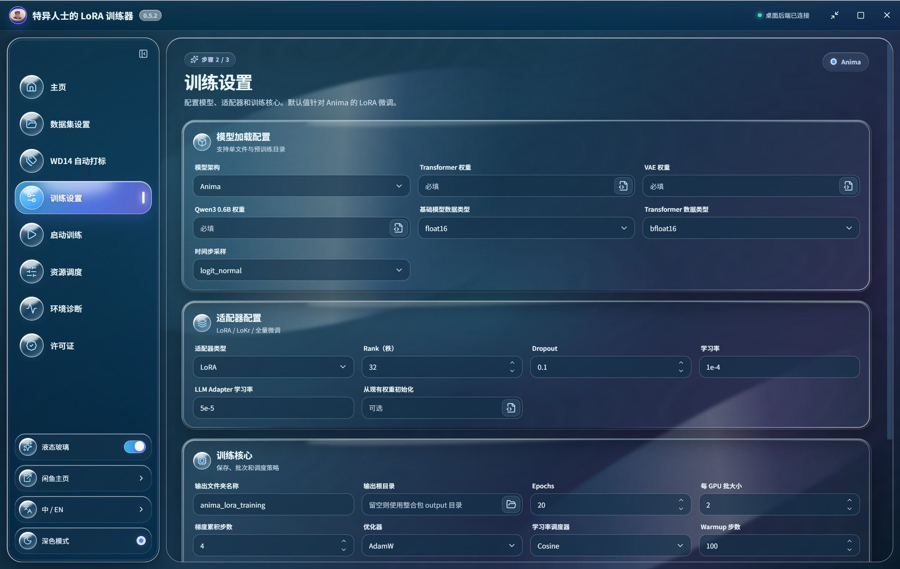

<div align="center">

# Teyi's LoRA Trainer

### 特异人士的 LoRA 训练器

Windows 桌面训练工作台 · 液态玻璃界面 · WD14 自动打标

[](https://github.com/114514dude/Teyi-LoRA-Trainer/releases)
[](CHANGELOG.md)
[](LICENSE)

[下载源码](https://github.com/114514dude/Teyi-LoRA-Trainer/archive/refs/heads/main.zip) · [本版更新](CHANGELOG.md) · [反馈问题](https://github.com/114514dude/Teyi-LoRA-Trainer/issues)



</div>

## 功能

- **训练配置**：模型权重、LoRA / LoKr、学习率、批次、Epoch、保存策略集中设置。
- **数据集管理**：递归统计图片与同名 TXT 标注，设置分辨率、重复次数和验证集。
- **WD14 自动打标**：使用 `SmilingWolf/wd-eva02-large-tagger-v3`，支持触发词、屏蔽词与 CPU 回退。
- **训练控制台**：展示步数、Epoch、Loss、学习率与耗时，保留完整原始日志。
- **环境诊断**：检查训练核心、嵌入式 Python 与运行环境。
- **界面主题**：液态玻璃、深浅色主题、中英文切换。

## 界面

| 数据集设置 | WD14 自动打标 |
| :---: | :---: |
|  |  |



## 0.6.1 更新

- 授权引导采用白色卡片，提升请求码与输入区域的可读性。
- 调整标题、说明与按钮对比度，简化表单背景效果。

## 0.6.0 更新

- 从训练核心采集结构化状态事件，连接训练进度与指标显示。
- 按模型能力校验配置，过滤不适用的参数。
- 增加 SDXL 标注长度预检，定位超过 CLIP 77 Token 的文件。
- 改进 Windows 日志解码、回车进度处理与原始日志保存。
- 增加 WD14 逐图统计、任务汇总和环境缺失提示。

## 使用

1. 在 [Releases](https://github.com/114514dude/Teyi-LoRA-Trainer/releases/tag/v0.6.0) 下载 Windows EXE。
2. 将 EXE 放到原训练整合包根目录，目录结构如下。
3. 打开应用，设置数据集、模型和训练参数，检查配置后启动训练。

```text
训练整合包/
├─ Exceptional-LoRA-Trainer-0.6.0.exe
├─ app/backend/core/train.py
└─ python_embeded_DP/python.exe
```

训练与打标使用本机 Python、GPU 和模型。此历史版本包含离线设备授权入口。

## 开发

需要 Node.js 22.12+；后端测试需要 Python 3.11+。

```bash
npm ci
npm run dev
```

```bash
python -m unittest discover -s tests -v
npm run build
npm run dist:win
```

## 项目

维护：**特异人士AIGC（闲鱼）** · [GitHub](https://github.com/114514dude) · [闲鱼](https://www.goofish.com/)

桌面界面与桥接层对接 [diffusion-pipe](https://github.com/tdrussell/diffusion-pipe) 训练核心，整合包来源为 [DiffPipeForge](https://github.com/TianDongL/DiffPipeForge)。依赖与模型许可见 [第三方说明](THIRD_PARTY_NOTICES.md)。源码采用 [GPL-3.0](LICENSE)。
